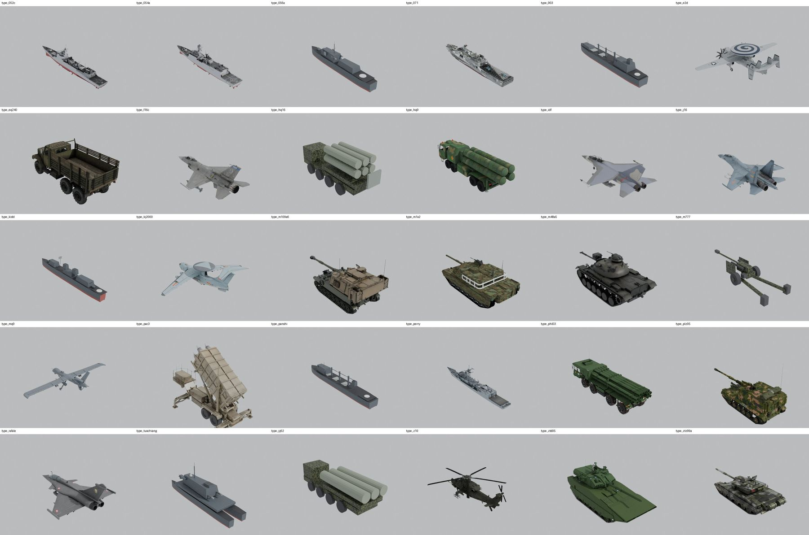

# 军事目标三维模型体系评估与优化方案

车辆 / 舰船 / 飞机 · situation3d 目标模型 v3 前期研究

- 日期：2026-10-26
- 范围：`situation3d/web/assets/models/` 现有 30 型目标模型、渲染与特效代码、外部开放模型资源
- 基线：独显工作站（用户确认）；30 型全量 + 台海密集转运案例 80 目标
- 状态：**只做评估与方案，未改动任何资产、代码或 8848 演示服务**

---

## 0. 结论摘要

**现状一句话：** 现有 30 型模型"型号覆盖做得不错，但存在三类硬伤——关键型号是错配近似、60% 的目标（ZTD-05/EQ240）模型面数失控、以及全系统没有任何车辆轮系/履带/旋翼（除 Z-10）的模型级动画。"

关键量化结果：

| 指标 | 现状 | 说明 |
|---|---:|---|
| 模型数量 | 30 型（+6 个炮塔/发射箱代理） | 22 个 Sketchfab，8 个 Blender 自建 |
| 总文件体积 | **61.6 MB** | 纹理 20.1 MB，其余为几何/JSON |
| 总三角面 | **776,634** | 平均 25.9k/型，最高 071 60.3k |
| 总绘制批次（primitive） | **774** | PHL-03 单模型 228 个，是最大异常 |
| 模型自带动画 | **0** | 30 型 GLB 全部无 animation；Z-10 旋翼靠节点驱动 |
| 台海密集案例（80 目标） | **≈300 万面 / 1,582 draw calls** | ZTD-05×36 + EQ240×24 占 74% 面数、68% 批次 |
| 中印案例（10 目标） | 8 个有模型，327 draws / 18.4 万面 | 2 个目标无模型（H03/H04） |
| `/assets/` 缓存 | **`Cache-Control: no-store`** | 每次刷新重新下载 61.6 MB |

**优先建议（按投入产出排序）：**

1. **P0（2–3 天，先做）**：把 `/assets/models/` 纳入可缓存前缀；合并 PHL-03 的 228 个 primitive；对纹理做 JPEG/KTX2 压缩；补上 `manifest.json` 与预算校验脚本。预计体积 −50%、draw calls −20%，不改任何外观。
2. **P1（约 2 周）**：优先解决"错配 + 低模"六型：052D（052C 改型）、KJ-500（Y-9 自建）、15 式（99A 改型）、CM-11（M48A5 + M60A3 炮塔）、056A/903/磐石/基隆/沱江（自建细节升级）、M777（换 CC-BY 现成模型）。
3. **P2（约 2 周）**：轮系/履带/炮塔/旋翼/雷达的模型级关节；尾流、扬尘、尾焰、通信链路等引擎侧特效。
4. **P3（约 1 周）**：LOD1/LOD2、重复目标实例化、真机 GPU 性能验收；目标把密集案例压到 **≤120 万面 / ≤600 draws**。

**外部资源结论：** 现实军模的可用来源实际上只有 Sketchfab（CC-BY 为主）；中文/台海装备的精确资产非常稀缺——**052D、KJ-500、15 式、075、CM-11、CM-34、沱江、基隆、056A、903、磐石、HQ-16、YJ-62 均未找到可下载的精确 CC 资产**，必须改造现有模型或自建。可采购/采用的现成候选只有 M777、M60A3（CM-11 炮塔 donor）、AH-64D、HIMARS、055、J-20 等少数几型（详见 §3.3）。

**合规红线（重要）：** 现有资产中 `type_052c`、`type_kj2000` 标注为 "DCS World" 提取物，`type_ztd05`、`type_phl03` 为 Sketchfab "Free Standard"；上传者的 CC-BY 声明不能治愈上游游戏版权，且 Free Standard 对"再分发模型文件"有限制。建议在 v3 中把它们列入替换/法务确认清单（§3.2、§8）。

---

## 1. 现状盘点

### 1.1 资产与管线

- 目录：`situation3d/web/assets/models/`，命名 `type_<型号>.glb`；`CREDITS.md` 记录来源与许可；`bboxes.json` 记录世界包围盒。
- 归一约定（2026-10-20 v2 建立）：1 单位 = 1 米、`scale=1`；舰船原点在水线、车辆在地面、飞机在包围盒中心；Blender +Y 为艏/头；Cesium 1.145 实测模型局部前向为 **-X**（`EntityLod.forwardAxis()`）。
- 例外：`type_ztd05`、`type_eq240` 导出后车头落在 +Z，由 `MODEL_YAW_FIX_DEG` 统一补 180°。
- 管线脚本：`tools/modelgen/normalize_glb.py`（朝向、米制、减面、贴图上限）、`shrink_textures.py`（512/1024 JPEG）、`build_custom.py`（8 型自建）、`tools/model_bboxes.py`。
- 代理件：052C/054A/071/99A/M1A2 各有一个 `*_gunfx.glb` 炮塔，HQ-9 有 `*_launcherfx.glb` 发射箱，均为独立 Entity，不修改原模型。

### 1.2 量化统计

30 型主模型合计：**61.6 MB、776,634 三角面、774 个 primitive、20.1 MB 纹理**。体积与批次 Top 8：

| 资产 | MB | 三角面 | primitive | 材质 | 图片 | 备注 |
|---|---:|---:|---:|---:|---:|---|
| type_j16.glb | 5.96 | 50,255 | 55 | 17 | 33 | 纹理 2.96 MB，33 张贴图 |
| type_071.glb | 5.68 | 60,293 | 32 | 26 | 11 | 26 个材质，合批空间大 |
| type_052c.glb | 4.94 | 50,029 | 25 | 20 | 7 | PNG 未转 JPEG，1.88 MB 纹理 |
| type_f16c.glb | 4.74 | 45,189 | 42 | 13 | 24 | 42 个 primitive |
| type_plz05.glb | 3.93 | 40,388 | 34 | 20 | 56 | 56 张图！多为小尺寸 |
| type_kj2000.glb | 3.75 | 55,115 | 20 | 17 | 7 | 作为 KJ-500 近似，尺寸偏大 |
| type_e2d.glb | 3.70 | 39,998 | 4 | 4 | 13 | 批次控制最好之一 |
| type_perry.glb | 3.65 | 34,993 | 9 | 9 | 8 | 1024² PNG 未压缩 |

异常项：`type_phl03.glb` **228 个 primitive / 426 个节点 / 11 材质 / 0 纹理**，单模型占全部 draw calls 的 29%；`type_ztd05.glb` 35,192 面 × 36 个实例、`type_eq240.glb` 39,995 面 × 24 个实例，是密集案例的主要负载。

案例装载估算（按 `EntityLod` 规则逐目标映射，当前资产）：

| 案例 | 目标数 | 有模型 | 估算 draw calls | 估算三角面 | 主要构成 |
|---|---:|---:|---:|---:|---|
| india_china_west | 10 | 8 | 327 | 184,252 | 99A、EQ240、MQ-9×2、阵风、M777、HQ-16、PHL-03 |
| taiwan_dense_transfer_v1 | 80 | 80 | 1,582 | 3,004,938 | ZTD-05×36、EQ240×24、071×4、Perry×3、沱江×3…… |

> 结论：**只优化 ZTD-05 与 EQ240 两型**（LOD + 合批/实例化），就能消掉密集案例约 74% 的面数和 68% 的 draw calls，是性价比最高的一刀。

### 1.3 运行时能力（代码现状）

- `entityLod.js`：按 3000 m 进 3D / 3600 m 回 2D（20% 迟滞）；型号→资产规则 + 大类回退；`wheelNodes()` **恒返回空数组**；`MODEL_YAW_FIX_DEG` 处理两型倒车。
- `targetMotion.js`：CZML 统一位置/姿态；空中目标按高度差给俯仰、按航向变化率给滚转；地面/水面用运动矢量逐帧解算航向；姿态与位置共用时间源，暂停/拖动同步。
- `targetFx.js`：车轮本应通过 `nodeTransformations` 驱动，但 `wheelNodes()` 为空 → **实际没有轮子/履带滚动**；`formClass === 'armor'` 是 v2 遗留分支（新资产已无 `armor` 类），属于死代码；船尾流、飞机尾气均为回溯 CZML 的发光折线，性能好、方向天然跟随航迹。
- `targetCombatFx.js`：开火/命中/击毁/扫描全部用 billboard + 折线（因为 `viewer.clock.shouldAnimate=false`，ParticleSystem 不发射）；已有代理炮塔后坐、Z-10 主/尾旋翼、HQ-16 雷达、YJ-62 发射筒抬升；击毁时舰船 12 s 下沉 7 m、飞机 8 s 落地的位置包装。
- `app.js`：`model.uri` + `scale=1` + `minimumPixelSize=6` + 阵营 `MIX 0.2` 混色；未开阴影。
- `server/serve.py`：`IMMUTABLE_PREFIXES = ("/tiles/", "/vendor/", "/tiles_db/", "/tdt/", "/tiles3d/")`，**`/assets/` 不在其中** → 所有 GLB 以 `no-store` 下发；这是加载时间与带宽的纯浪费。
- 资源加载：Cesium 按 Entity 各建 Model，无跨实体实例化；同型 36 个 ZTD-05 就是 36 份独立 draw calls。

---

## 2. 真实性评估

### 2.1 方法

1. 用修改后的 `glb_inspect.py` 解析 30 个 GLB 的 JSON chunk：三角面、primitive、材质、贴图尺寸/字节数、动画、扩展。
2. 用 `bboxes.json`（世界变换后的包围盒）与公开规格（Wikipedia/厂商公开数据）对比长度、翼展/舰宽、高度。
3. 用 Blender 4.5.10 + Cycles CPU 对 30 个模型逐一渲染 3/4 视角（480×360，16 samples），拼成联系表做外观目检（附录 B）。渲染脚本为临时工具，未入库。
4. 对照 `CREDITS.md` 与原始 Sketchfab 条目核对来源/许可。

### 2.2 总体结论

- **22 个 Sketchfab 资产**：几何与材质总体可信，尺寸多数按公开全长归一，外观可用于 1.5–3 km 视距；主要问题是面数/材质/贴图冗余，以及少数型号近似。
- **8 个自建资产**（056A/903/磐石/基隆/沱江/HQ-16/YJ-62/M777）：轮廓和比例基本对，但上层建筑、栏杆、传感器、甲板设备等细节明显偏"积木"，近看与实船差距大；贴图为程序化板缝/锈迹/迷彩，重复感强。
- **尺寸精度**：24 型长度/翼展与公开值偏差 ≤5%；3 型 5–10%（Perry 舰宽 +10%、M48A5 长度 −4.5%、IDF 翼展 +9%）；4 型存在结构性错配（052D/KJ-500/15 式/CM-11，见 §2.4）。
- **高度普遍含天线**：M1A2、M109A6、PLZ-05、ZTD-05 等包围盒高度比公开"至炮塔顶"高 20–45%，目检为鞭状天线/桅杆所致，不是模型比例错误；但用 bbox 做碰撞/遮挡时需按"车体高度"另存一份。
- **动画**：30 型 GLB 全部无 glTF animation；Z-10 旋翼、HQ-16 雷达、YJ-62 发射筒靠节点名 + `nodeTransformations` 驱动（见 `targetCombatFx.RIGS`），其余可动件均未拆分。
- **材质扩展**：部分 Sketchfab 资产带 `KHR_materials_specular/ior/clearcoat`；Cesium 对非核心扩展的支持不完整，建议导出时统一转核心 metallic-roughness，避免不同版本渲染差异。

### 2.3 逐型号评估

**水面舰艇**

| 型号（资产） | 模型尺寸 L×W×H (m) | 公开值（约） | 评价 | 建议 |
|---|---|---|---|---|
| 052C（052D 近似） | 155.0×16.9×43.7 | 052C 155×17.2；052D 157×17.2 | 尺寸准确；但 052C 是弧形雷达罩，052D 是四块平板 AESA，舰桥/VLS 布置也不同 | **改型为 052D**（P1 最高优先） |
| 054A | 134.0×17.6×33.9 | 134×16.0 | 长度准；舰宽 +10%（含舷侧突出物），可接受 | 轻量化；不必重做 |
| 056A（自建） | 89.0×11.1×26.8 | 89×11.1 | 尺寸准；细节弱、上层建筑偏方 | 细节升级（P1） |
| 071 | 210.2×29.5×46.9 | 210×28 | 长度准；舰宽 +1.5 m；H 46.9 含桅杆/天线，合理但需复核 | 减面/合批；无需重做 |
| 903（自建） | 178.5×24.8×35.9 | 178.5×24.8 | 尺寸准；补给门架/吊机/舱段细节缺失 | 细节升级 |
| 基隆/Kidd（自建） | 173.8×16.8×41.7 | 171.6×16.8 | 长度 +1.3%；上层建筑与 SPY-1 阵面/ Mk 26 发射架不像 | 细节升级或换资产 |
| 成功/Perry | 135.5×15.1×34.5 | 135.6×13.7 | 长度准；舰宽 +1.4 m（舷侧/救生艇），略宽 | 可接受，轻量化 |
| 沱江（自建） | 60.4×14.0×24.2 | 60.4×14.0 | 尺寸准；双体船型/隐身上层建筑/导弹箱不够像 | 改型（P1） |
| 磐石（自建） | 196.0×25.9×41.1 | 196×25.5 | 尺寸准；补给舰设备细节弱 | 细节升级 |

**空中目标**

| 型号（资产） | 翼展/旋翼 × 机长 × 高 (m) | 公开值（约） | 评价 | 建议 |
|---|---|---|---|---|
| E-2D | 23.8×17.4×6.1 | 24.56×17.6×5.58 | 翼展 −3%、机高 +10%（含天线），整体好 | 轻量化即可 |
| KJ-2000（用于 KJ-500） | 51.9×46.6×15.6 | KJ-2000 50.5×46.6；KJ-500 38.0×36.0 | 作为 KJ-2000 准确；作为 KJ-500 大 30–40% | **自建 KJ-500（Y-9 机体）** |
| 歼-16（Su-30MKK） | 14.3×21.9×5.7 | 14.7×21.9×6.4 | 长度准；翼展 −3%；机高偏低（未放起落架/垂尾差异） | 可接受；补起落架更真实 |
| F-16C | 9.6×15.0×4.7 | 9.96×15.06×4.88 | 三项均 ≤4% | 轻量化即可 |
| IDF | 9.8×14.2×4.7 | 9.0×14.48×4.65 | 翼展 +9%（可能含翼尖导弹）；长度/高度准 | 可接受；核对挂载 |
| 阵风 | 10.8×15.3×5.5 | 10.9×15.27×5.34 | 三项均 ≤3% | 轻量化即可 |
| 直-10 | 11.7（旋翼）×14.2×4.7 | 12.0×14.15×3.85 | 旋翼 −2.5%；机高含桅顶 | 保持；旋翼动画已有 |
| MQ-9 | 19.4×11.0×4.0 | 20.1×11.0×3.81 | 翼展 −3.5%；其余准 | 轻量化即可 |

**地面目标**

| 型号（资产） | 模型尺寸 L×W×H (m) | 公开值（约） | 评价 | 建议 |
|---|---|---|---|---|
| 99A | 11.0×3.7×2.7 | 11.0×3.5×2.37 | 长准；宽 +6%、高 +16%（含天线） | 可接受；碰撞用低包络 |
| M1A2 | 9.8×3.6×3.6 | 9.77×3.66×2.44 | 长/宽准；高 +47% 为天线 | 可接受；碰撞用低包络 |
| M48A5（CM-11 近似） | 8.3×3.4×2.9 | 8.69×3.63×3.09 | 长 −4.5%、宽 −7%；且 CM-11 是 M60A3 炮塔 | **CM-11 换炮塔（用 M60A3 donor）** |
| M109A6 | 9.7×4.0×4.6 | 9.7×3.9×3.1 | 长/宽准；高含天线 | 可接受 |
| PLZ-05 | 11.6×3.8×6.3 | 11.6×3.4×3.5 | 长准；宽 +12%；高含天线/抬炮 | 复核高度；轻量化 |
| PHL-03 | 11.0×3.1×4.3 | 11.5×3.4×4.3 | 接近；但 228 个 primitive 是性能炸弹 | **P0 合并几何** |
| HQ-9 | 12.0×3.1×3.8 | 12×3.5×3.8 | 长/高准；宽 −11%；有具名轮节点未用 | 启用轮系 |
| HQ-16（自建） | 12.1×3.5×4.9 | ≈11×3.3×4.0 | 偏大；细节弱 | 改型/升级 |
| PAC-3 | 12.0×6.6×8.2 | 12×2.9×3.3（行军） | 模型是**展开射击状态**（发射箱抬起、支腿展开），不能直接当行军状态 | 增加行军状态版本或动画折叠 |
| M777（自建） | 10.2×3.3×1.8 | 10.2×3.3×1.8 | 尺寸准；仅 972 面，细节极简 | **换 CC-BY M777 候选** |
| ZTD-05 | 9.5×3.7×4.9 | 9.5×3.36×3.0 | 长准；宽 +10%、高含天线；15 材质/22 批次 | 减面、合材质（密集案例关键） |
| EQ240 | 6.9×2.5×3.0 | 6.9×2.47×2.6 | 尺寸准；40k 面对卡车过高；6 材质 | 减面、合材质（密集案例关键） |
| 鹰击-62（自建） | 13.0×3.9×4.0 | ≈13×2.5×3.6 | 偏宽；发射筒/底盘细节弱 | 细节升级 |

> 说明：表中"公开值"为公开资料的近似值，用于判断量级与比例，不作为工程标定；舰船高度受桅杆/天线定义影响，单独标注。

### 2.4 重点问题（按影响排序）

1. **型号错配 4 处**：052D→052C、KJ-500→KJ-2000、15 式→99A、CM-11→M48A5。前两者在台海案例中是高价值主战装备，错配最显眼；15 式与 99A 的体量/轮廓差异大（33 t vs 55 t），CM-11 炮塔形状完全不同。
2. **8 个自建模型细节不足**：056A/903/磐石/基隆/沱江在 1.5 km 内明显"积木感"；M777/HQ-16/YJ-62 更简。它们占型号数 27%，但都是案例中的常见目标。
3. **密集案例负载集中在两型**：ZTD-05（36 个）与 EQ240（24 个）合计 74% 面数；每型都是"高面数 + 多材质 + 无 LOD"。
4. **动画缺失**：轮式车辆无轮节点（HQ-9 明明有 `$wheel0..7` 却未注册）；履带车无履带滚动；除 Z-10 外直升机旋翼不转；舰船雷达不转；发射箱/舱门无动作。
5. **性能债**：PHL-03 228 批次；J-16 55 批次/33 图；PLZ-05 56 图；052C/Perry 用 1024² PNG；`/assets/` 不可缓存。
6. **许可风险**：DCS 提取物 2 型、Free Standard 2 型（详见 §3.2）。

---

## 3. 外部开放资源调研

> 调研方法：2026-10-26 通过 Sketchfab 公共搜索 API（`type=models&downloadable=true`）按型号逐条检索，记录许可、面数、GLB 体积、贴图；辅以 OpenGameArt、FlightGear、Quaternius/Kenney、Free3D/CGTrader/TurboSquid 等渠道的公开页面核对。检索结果会随时间变化，采购前需复查模型页。

### 3.1 渠道矩阵

| 渠道 | 典型许可 | 格式 | 质量/覆盖 | 对本项目适用性 |
|---|---|---|---|---|
| **Sketchfab** | CC0 / CC-BY / CC-BY-SA / CC-BY-ND / CC-BY-NC / Free Standard | glTF/GLB、FBX、OBJ、USDZ | 现实军模最全；舰船/飞机/车辆均有；质量差异大 | **主渠道**；只取 CC0/CC-BY；逐模型核对上传者与上游来源 |
| FlightGear / FGAddon | **GPL-2.0**（传染性 copyleft） | AC3D `.ac` + XML | 军机/民航机飞行模型细致，含座舱/起落架/舵面 | 仅作参考或内部研究；**不要直接并入闭源分发**；转换成本高 |
| OpenGameArt | CC0 / CC-BY / GPL | OBJ/FBX/blend | 军事 3D 仅 39 条，多为箱子/低模坦克/道具 | 仅适合占位或 LOD2，不适合真实装备 |
| Quaternius | CC0 | FBX/OBJ/glTF | 低多边形风格化军事包 | 占位/LOD 远景可用；不适合近景真实感 |
| Kenney | CC0 | GLB/FBX/OBJ | 卡通/低模车辆、船、建筑 | 同上；现有旧资产即此类，已被 v2 淘汰 |
| Free3D | 多为 "Personal Use Only" / 少量 Royalty Free | 3ds/max/obj/fbx | 军模数量多，质量参差 | 许可普遍不适合分发；需逐条确认，不推荐作为主渠道 |
| CGTrader / TurboSquid | 平台自有 "Royalty Free"/"Editorial" | 多格式 | 高质量军模多，免费区有限 | 可购买；注意"不得再分发原始模型"条款；适合少量关键型号 |
| NASA 3D / Smithsonian Open Access | 公共领域 / CC0 | glTF/OBJ | 航天器、历史飞机为主，现代军机少 | 补充少量机型；不解决主战装备 |
| GitHub 开源仓库 | 混合（GPL/CC0） | 混合 | FlightGear 衍生、低模包、CAD | 需逐个查 LICENSE；优先 CC0/CC-BY |
| 游戏提取物（DCS/War Thunder/战舰世界） | **禁止**（EULA） | 混合 | 外观最像 | **不可用**；现有 2 型即属此类，见 §3.2 |

### 3.2 授权与合规要点

- **CC0**：可商用、可修改、无署名义务；最安全。
- **CC-BY**：可商用、可修改，必须署名（本项目已在 `CREDITS.md` 汇总，可满足）。
- **CC-BY-SA**：衍生作品需同许可共享；本项目若分发模型需评估。
- **CC-BY-ND**：禁止修改；**不能减面/改材质**，与轻量化目标冲突 → 排除（如 441k 面的 055 ND 版）。
- **CC-BY-NC**：禁止商业使用；若项目未来商业化则不能用 → 保守排除（如 Mirage 2000、F-2 的 NC 版）。
- **Sketchfab "Free Standard"**：平台自有许可，允许在项目中使用/修改，但通常**禁止把模型本身作为独立资产再分发/转售**。本项目通过 Web 把 GLB 下发给浏览器，是否构成"再分发"需法务判断；建议逐步替换为 CC-BY/CC0 或自建（现有 ZTD-05、PHL-03 属此类）。
- **GPL（FlightGear）**：分发衍生作品需以 GPL 提供相应源码/资产；与本项目闭源分发不兼容。可内部研究/参考，不建议并入产品。
- **上游版权**：Sketchfab 上传者标 CC-BY 不代表其有权授权。标注 "DCS World"、"Not my model"、或明显来自 3D Warehouse/游戏提取的条目，存在上游侵权风险。**现有 `type_052c`、`type_kj2000` 属 DCS 提取物，建议列入替换清单**；`HIMARS`、`P-3C`、`E-2` 等候选也有类似提示（见 §3.3）。
- **建议的内部规则**：新资产只接受 CC0/CC-BY + 可追溯作者/原始页面；入库时在 `manifest.json` 记录 `source_url / author / license / license_url / downloaded_at / sha256`；ND/NC/GPL/来源不明一律不入库。

### 3.3 可用候选清单（Sketchfab，2026-10-26 检索）

| 候选 | 用途 | 许可 | 面数 | GLB 体积 | 贴图 | 结论 |
|---|---|---|---:|---:|---|---|
| [M777 howitzer](https://sketchfab.com/models/2a2c381888ef4e4790ed883cddda0aca)（miloschnack） | 替换自建 M777 | CC-BY | 182,675 | 8.4 MB | 0（纯材质） | **采用**；减面至 12–15k + 重做 PBR/迷彩 |
| [M60A3 Patton](https://sketchfab.com/models/3d298af87c2c4a0691e61ab8ee9ad803)（jonathanto99） | CM-11 炮塔 donor | CC-BY | 117,366 | 5.8 MB | 0 | **采用（局部）**；取炮塔/炮管，装到 M48A5 车体 |
| [AH-64D Apache](https://sketchfab.com/models/c3b58008c46b45048fdd7dd283a3c8c8)（MirzaArrafiERV_45） | 扩充 AH-64E 近似 | CC-BY | 21,882 | 3.4 MB | 9×1024 | **建议扩充**；台湾现役机型，性价比高 |
| [M142 HIMARS](https://sketchfab.com/models/95d255cd685e4cc5afc35ba5f58679d4)（42manako） | 扩充 HIMARS | CC-BY | 22,451 | 6.8 MB | 4×2048 | 可用；作者注明 "Not my model"，需查上游 |
| [Type 055 Destroyer](https://sketchfab.com/models/f0a96b2475da407eb6ea2b430ba9ea85)（hrd4588） | 扩充 055 | CC-BY | 77,392 | 4.1 MB | 1×64（顶点色风格） | 可用；需重贴图/减面 |
| [Chengdu J-20](https://sketchfab.com/models/735da22f59d04542b5b33e5b8fd699b1)（miopass） | 扩充 J-20 | CC-BY | 411,646 | 12.6 MB | 0 | 可用但重；减面至 25k + 重做材质 |
| [P-3C Orion](https://sketchfab.com/models/be11ab6c970741d78e62c9d8ff2e33e8)（ammardhamiri1，模型 by mandun/3D Warehouse） | 扩充 P-3C | CC-BY | 150,296 | 6.8 MB | 0 | 谨慎；来源/许可链不清晰，需重做纹理 |
| [76mm H/PJ26](https://sketchfab.com/models/0c88bdaddd104020bcd1c978e0dbb3e5)（Lemper_Studio） | 054A/056A 舰炮细节 | CC-BY | 3,780 | 0.45 MB | 2×1024 | 可采用为细节 donor |
| [E-2 Hawkeye](https://sketchfab.com/models/a7466570f07949feb054425620a66bb3)（helijah） | E-2 备份 | CC-BY | 80,274 | 5.1 MB | 29×1024 | 现有 E-2D 更好，不采用；注意其为 FlightGear 模型再上传 |
| [Type 055 (Free)](https://sketchfab.com/models/c0a3c5cb49fd4b688b65e4f3a18b5917)（andertan） | — | CC-BY-**ND** | 420,311 | 29.3 MB | 0 | **排除**：ND 禁止修改/减面 |
| [Mirage 2000](https://sketchfab.com/models/aca93654c4684c5282e723c5b2999f67)（bohmerang） | — | CC-BY-**NC**-SA | 30,994 | 27.8 MB | 3×4096 | **排除**：NC；且声明仅个人使用 |

**检索缺口的型号（未找到可下载的精确 CC 资产）**：052D、KJ-500、ZTQ-15/15 式、075、CM-11、CM-34、沱江、基隆、056A、903、磐石、HQ-16、YJ-62、M1A2T。对这些型号，v3 只能"改现有"或"自建"。

### 3.4 资源采用结论

- **直接采用（轻量化后）**：M777；M60A3（仅炮塔）。
- **改造后采用**：AH-64D→AH-64E 近似；HIMARS（先查上游）；055（重贴图）；J-20（重减面/重材质，可选）。
- **不采用**：ND/NC/GPL 资产、来源不明的游戏提取物、低模风格化包（除远景 LOD）。
- **必须自建/改型**：052D、KJ-500、15 式、075、CM-11、056A 细节、903/磐石/基隆/沱江细节、HQ-16/YJ-62 细节。

---

## 4. 动态行为与特效方案

### 4.1 分工原则

- **模型级（glTF 节点/关节）**：持续循环且与事件无关的动作——车轮、履带、旋翼、雷达旋转、炮塔/炮管俯仰、发射箱起竖、起落架/舱门。用 `nodeTransformations` 驱动；节点名、旋转轴、pivot 在 Blender 里定好。
- **引擎级（billboard/折线/自定义材质）**：与事件或环境相关的效果——枪口焰、爆炸、烟、扬尘、尾流泡沫、尾焰、通信链路、扫描扇区、下沉。现有 `targetCombatFx` 的池化 billboard 方案已验证可行，继续沿用。
- **不烘焙事件动画**：开火时刻由案例 `events[]` 决定，glTF 剪辑无法按事件选播；事件驱动效果必须留在引擎侧。
- **时间源统一**：全部从 `viewer.clock`/`tickFloat` 取状态，保证暂停、拖动、回放一致（现有约定）。
- **ParticleSystem 禁用**：`viewer.clock.shouldAnimate=false`，粒子不发射；用 billboard 池 + 每帧更新替代（现有做法）。

### 4.2 车辆

| 效果 | 实现 | 优先级 | 备注 |
|---|---|---|---|
| 车轮滚动 | Blender 中将轮子拆为 `wheel_*` 节点（原点在轮心），登记到 `EntityLod.WHEEL_NODES`；`targetFx.updateWheels()` 已支持 | P2 | HQ-9 已有 `$wheel0..7`，先注册即可；其他轮式车需重导出 |
| 履带滚动 | 两种方案：① 履带材质 UV 随速度滚动（CustomShader/自定义 material）；② 履带链节拆成节点做位移循环 | P2 | 99A/M1A2/ZTD-05/PLZ-05 等；优先 UV 滚动，成本低 |
| 炮塔/炮管 | 拆 `turret`/`gun` 节点，按目标方位/俯仰驱动；现有代理炮塔只覆盖 5 型，建议改为模型内节点 | P2 | 减少代理 Entity 数量，开火后坐更自然 |
| 行驶扬尘 | 车尾 billboard 尘团池（上限 60），按速度/地面类型启停，20 km 内可见 | P2 | 比粒子便宜；与现有烟团共用贴图 |
| 车队间距/编队 | 已有仿真轨迹；视觉上避免同型车完全重叠（轻微横向偏移） | P3 | 数据层不改，仅渲染偏移 |

### 4.3 舰船

| 效果 | 实现 | 优先级 | 备注 |
|---|---|---|---|
| 尾流（现有） | 回溯 CZML 的两层发光折线，方向随航迹 | 已有 | 可在尾部加 2–3 层渐隐线模拟扩散 |
| 舰艏浪 | 艏部两条短折线 + 泡沫 billboard，速度 >5 kn 显示 | P2 | 与尾流同源，成本低 |
| 螺旋桨洗流 | 艉部 billboard 泡沫团，速度/吨位决定强度 | P3 | 可选 |
| 雷达旋转 | 桅杆雷达节点绕竖轴旋转（如 054A/056A 的 2D 对空雷达）；相控阵不转 | P2 | 需在 Blender 拆节点；KJ-2000/E-2D 的雷达罩不转（相控阵/内部旋转），保持静态 |
| VLS/导弹发射 | `fire` 事件且武器为导弹时，在 VLS 区域生成垂直燃气羽流 + 甲板闪光；可加舱盖开启节点 | P2 | 052C/052D/054A 的 VLS 位置需按型号标定 |
| 中弹/下沉（现有） | 压暗 + 烟柱 + 12 s 下沉 7 m；可加倾覆 roll | 已有/增强 | 倾覆用实体 orientation 包装，注意与 CZML 姿态叠加 |
| 航行姿态 | 现有仅航向；可加轻微纵摇/横摇（按海况/速度） | P3 | 视觉增强，不影响数据 |

### 4.4 飞机

| 效果 | 实现 | 优先级 | 备注 |
|---|---|---|---|
| 姿态（现有） | CZML 俯仰/滚转，转弯压坡度 | 已有 | 保持 |
| 尾焰/加力 | 尾喷口 billboard 锥体（加力时更长更亮），速度阈值/事件驱动 | P2 | 歼-16/阵风/F-16 等；现有尾气折线可保留为"烟迹" |
| 凝结尾迹 | 高度 >8 km 时用长折线/ billboard 轨迹，随高度/湿度淡出 | P2 | 现有尾气只在低空/近距离；凝结尾迹是高空主要视觉 |
| 旋翼旋转 | Z-10 已有；AH-64/Z-9/UH-60 等新增机型同样拆主/尾旋翼节点 | P2 | 直升机低空悬停时加下洗尘环 |
| 起落架/襟翼 | 起落架收放动画（起飞/降落阶段） | P3 | 需要仿真阶段数据；可选 |
| 导弹发射 | 翼下/机腹挂点闪光 + 导弹 billboard（现有 projectile 可复用） | 已有/增强 | 按机型标定挂点 |

### 4.5 攻击、通信与状态特效

- **攻击**：现有枪口闪光、曳光/导弹、命中红闪、爆炸、烟柱、扫描扇区可继续用；补充"舰炮/坦克炮模型内炮塔后坐"替代代理件。
- **通信**：新增"数据链弧线"——选中目标时，向其 `sensor_range_km`/`influence_km` 内的友军画一条低亮度虚线弧（polyline + 流动 dash），表达指挥/协同关系；通信状态可由案例事件或角色卡字段驱动。成本低、观感好。
- **雷达探测**：现有"选中目标扫描扇区"保留；可对预警机/舰载雷达增加周期性扫描扇区（仅低空/近距离，限制数量 ≤3）。
- **毁伤**：现有烟雾/火焰/下沉保留；后续可加"残骸模型"（舰船倾覆、车辆焦黑）按需。
- **状态灯**：红蓝阵营混色已有；可加受损闪烁/通信高亮，但避免过度。

### 4.6 代码落点

| 文件/函数 | 改动 |
|---|---|
| `entityLod.js` `wheelNodes()` | 从空数组改为按资产 URL 返回 `[{name, axis, radius}]` 表；先接 HQ-9 的 `$wheel0..7` |
| `entityLod.js` `MODEL_YAW_FIX_DEG` | 新资产入库时逐型实测；保持"倒着走就登记"的机制 |
| `targetFx.js` `updateWheels()` | 已支持；补充轮径/轴；按速度方向反转 |
| `targetFx.js` `updateModelAnimations()` | 删除/改造 `formClass === 'armor'` 死分支；改为按资产表驱动履带/旋翼 |
| `targetFx.js` `makeWake()` | 增加艏浪、尾流分层、速度阈值；保持折线回溯 |
| `targetFx.js` `makeExhaust()` | 增加加力锥、凝结尾迹、喷口偏移表 |
| `targetCombatFx.js` `RIGS` | 扩展炮塔/雷达/VLS/舱门节点；按型号维护 pivot/轴 |
| `targetCombatFx.js` `PROXY` | 随模型内炮塔上线逐步退场，减少代理 Entity |
| `targetCombatFx.js` `onFire()` | 增加 VLS/挂点发射位置表；通信链路事件 |
| `app.js` `createTargetEntities()` | `nodeTransformations` 已接入；新增 LOD URI 切换/实例化入口 |
| `server/serve.py` | 将 `/assets/models/` 加入可缓存前缀（配 `?v=` 或内容哈希） |

### 4.7 模型侧交付要求（给 Blender 管线）

1. 节点命名规范：`wheel_FL/FR/ML/MR/RL/RR`、`track_L/R`、`turret`、`gun`、`rotor_main`、`rotor_tail`、`radar_*`、`vls_*`、`hatch_*`。
2. 每个可动节点的原点在旋转轴心；导出前 `Apply Transform`（位置除外）。
3. 轴向：绕 Blender Z 旋转的部件（炮塔/轮转向）与绕 X 滚动的轮子，导出后在 Cesium 局部系的轴需实测登记；不要假设。
4. 材质统一核心 PBR（baseColor/metallic/roughness/normal/occlusion），不使用 `KHR_materials_clearcoat/ior` 等非核心扩展。
5. 贴图 ≤1024（远景 LOD ≤512），优先图集；单模型 ≤6 材质。
6. 每个 GLB 附 `bbox`（车体/全高两套）与 `license/source` 元数据（可写入 `extras`）。

---

## 5. 轻量化与性能方案

### 5.1 预算（LOD0，独显工作站基线）

| 类别 | 三角面 | primitive | 材质 | 贴图 | 文件体积 |
|---|---:|---:|---:|---|---:|
| 水面舰（大型） | ≤35k | ≤12 | ≤6 | ≤2×1024 | ≤2.5 MB |
| 水面舰（轻护/导弹艇） | ≤20k | ≤8 | ≤4 | ≤1×1024 | ≤1.2 MB |
| 飞机（战斗机/直升机/UAV） | ≤25k | ≤10 | ≤6 | ≤2×1024 | ≤1.5 MB |
| 飞机（预警机/运输机） | ≤30k | ≤12 | ≤6 | ≤2×1024 | ≤2.0 MB |
| 地面车辆（坦克/SPG） | ≤12k | ≤4 | ≤3 | ≤1×1024 | ≤0.5 MB |
| 地面车辆（卡车/发射车） | ≤10k | ≤4 | ≤3 | ≤1×1024 | ≤0.5 MB |
| LOD1（1.5–3.6 km） | L0 的 25–35% | ≤4 | ≤2 | ≤512 | ≤0.4 MB |

全量目标：30 型 **≤45 万面、≤350 批次、≤24 MB、纹理 ≤7 MB**。

### 5.2 几何

- 用 Blender Decimate（collapse）或 `gltf-transform simplify`（meshoptimizer）做减面；薄片/天线/栏杆单独保护，避免减面后消失。
- 按材质合并 primitive：同材质/同贴图图集的静态部件合并；可动件单独保留。目标：PHL-03 228→≤12，J-16 55→≤15，F-16C 42→≤12，PLZ-05 34→≤10。
- 去重：合并重复顶点、删除不可见面、去掉内部结构（舰船内舱、车辆底盘内部）。
- LOD1：对 ZTD-05/EQ240 这类高频目标优先做；LOD1 可用简化几何 + 512 贴图，远距离轮廓保持。

### 5.3 纹理与材质

- 现状 20.1 MB 纹理，227 张图（207 JPEG + 20 PNG）；PNG 主要出现在 052C/Perry/Rafale/EQ240/PLZ-05。
- 统一转 JPEG（q80–85）或 **KTX2/BasisU**：KTX2 可把显存占用降到约 1/4–1/6，下载体积约减半；Cesium 需配置 KTX2 transcoder（上线前验证 1.145 支持）。
- 图集：同模型多材质合并到 2048 图集（舰船）或 1024（车辆/飞机）；UV 重排后用 `gltf-transform` 合并材质。
- 材质：核心 PBR；金属度/粗糙度贴图可选；取消 clearcoat/ior/specular 扩展；法线贴图只在近景 LOD0 保留。
- 颜色：阵营混色 `MIX 0.2` 保留（不影响贴图），但避免每实体创建独立材质实例；必要时用统一的阵营 tint uniform。

### 5.4 加载与缓存

- **把 `/assets/models/` 加入 `IMMUTABLE_PREFIXES`**，配合内容哈希/`?v=` 查询参数；当前 `no-store` 会让每次刷新重下 61.6 MB。
- 预加载：案例加载后按目标型号并发预取 GLB（限制 4–6 并发），避免低空切换时集中卡顿；失败回退 2D 图标。
- 压缩：Meshopt（`EXT_meshopt_compression`）或 Draco；Cesium 两者均支持（需确认构建包含 decoder）。Meshopt 对 GLB 更友好、解码快。
- CDN/HTTP：确保 gzip/brotli 对 JSON/GLB 生效（GLB 已是二进制，压缩收益有限，但 JSON chunk 可压）。

### 5.5 运行期

- **距离 LOD**：沿用 3 km/3.6 km 阈值，另加 1.2–1.5 km 的 LOD0→LOD1 切换（滞回 15%）；优先验证 Cesium 对 `MSFT_lod` 的支持，若不支持则用两个 Entity 交替 `show`（预加载两版模型，避免 URI 切换重载）。
- **实例化**：ZTD-05×36、EQ240×24 是最大收益点。优先评估 `ModelInstanceCollection`/共享 `Model` 的可行性；若 Cesium 版本不支持，退而求其次：LOD1 + 合批，仍可大幅降面。
- **裁剪**：模型按相机距离/视锥显示；>60–80 km 的尾流/尾气已裁剪，模型本身也应只保留图标（现有 3.6 km 规则）。
- **渲染设置**：不开阴影；`minimumPixelSize=6` 保留；避免每帧重建材质/属性；颜色混色尽量批处理。
- **监控**：接入 `renderGovernor` 的帧率/长任务统计；低帧率时自动降 LOD/关闭扬尘等非关键特效（分级降级）。

### 5.6 预期收益（估算）

| 指标 | 现状 | 目标 | 变化 |
|---|---:|---:|---:|
| 30 型总体积 | 61.6 MB | ≤24 MB | −61% |
| 30 型总面数 | 776,634 | ≤450,000 | −42% |
| 30 型总批次 | 774 | ≤350 | −55% |
| 纹理字节 | 20.1 MB | ≤7 MB | −65% |
| 密集案例面数 | ≈3.0 M | ≤1.2 M | −60% |
| 密集案例批次 | 1,582 | ≤600 | −62% |
| 首次加载（100 Mbps） | ≈5 s + 无缓存重复 | ≈2 s + 可缓存 | — |

> 注：以上为"P0+P1+P3"全部落地后的估算；仅 P0（合批+压缩+缓存）即可拿到约一半收益。

---

## 6. 集成与验证

### 6.1 分支与部署

- 报告提交到 `docs/target-models-v3` 分支（仅文档 + 联系表图片），不碰 8848。
- 代码/资产实施走 `feat/target-models-v3` 独立 worktree；每完成一个可验证阶段合并回 `main`，合并前跑完整校验。
- 8848 演示只在里程碑节点、经用户同意后由 `demo_update.sh` 更新；更新前保留回退版本（现有约定）。

### 6.2 自动化校验

新增/扩展以下脚本（放在 `situation3d/tools/`）：

1. `model_budget_test.py`：遍历 `type_*.glb`，断言三角面/primitive/材质/贴图尺寸/文件体积不超预算；输出 CSV。
2. `model_bbox_test.py`：把 `bboxes.json` 与 `specs.json`（公开长度/翼展/宽度）比对，偏差 >8% 报警（允许白名单：含天线高度、近似型号）。
3. `model_license_test.py`：检查 `manifest.json` 每个资产有 `source_url/author/license/sha256`；ND/NC/GPL/未知直接失败。
4. `entity_lod_test.js`：扩充型号映射、yaw fix、wheelNodes 用例；保持纯函数可跑。
5. `render_contact_sheet.py`（Blender）：30 型批量渲染，人工目检 + 归档对比图。
6. Playwright 端到端：1.5 km/3 km/6 km 三档截图；统计模型显示数、404、draw calls（通过 `scene` 调试接口或 Spector.js）。

### 6.3 验收标准

- **功能**：30/30 资产可加载、无 404；41/41 或 80/80 目标有模型 URI；倒车/朝向正确；LOD 切换无闪烁/无回退抖动。
- **尺寸**：长度/翼展/舰宽与公开值偏差 ≤8%（近似型号单独标注）；车体/全高两套 bbox 可用。
- **视觉**：联系表中 30 型轮廓/涂装可辨；1.5 km 处近景无明显"积木感"（重点型号）；轮子/旋翼/尾流/尾焰可见。
- **性能（RTX 3060/4060 级）**：密集案例 80 目标、1.5 km 视距，平均 ≥55 fps、p95 帧 ≤20 ms、draw calls ≤600；切 3 km/6 km 稳定；加载无 >50 ms 长任务集中出现。
- **体积**：30 型 ≤24 MB；单模型不超预算表；`/assets/models/` 命中缓存（第二次加载 0 网络请求）。
- **合规**：`manifest.json` 完整；DCS/Free Standard 资产有替换计划或法务结论。

### 6.4 性能测量方法

- 真机 GPU（非 headless SwiftShader）：Chrome + `--enable-gpu`；用 Cesium 自带 FPS/帧时间，配合 Spector.js 抓 draw calls/纹理内存；记录 1.5/3/6 km 三档、静止/巡航/交战三种状态。
- 记录指标：FPS 均值/p95、帧时间、draw calls、三角面、纹理显存估算、长任务、首模型可见时间。
- 对照基线：同一案例、同一机位、同一浏览器版本；改动前后各跑 3 次取中位数。

### 6.5 回滚

- 资产按版本目录/哈希命名，旧版保留一个周期；`manifest.json` 记录上一版；代码回滚只 revert 本特性提交（禁止 `reset --hard`）。
- 演示更新前备份到 `ops/` 约定的备份目录；回退用 `git revert` + 静态文件恢复。

---

## 7. 实施路线图

| 阶段 | 内容 | 产出 | 工期（1 人） | 依赖 |
|---|---|---|---:|---|
| **P0 快速收益** | 缓存头、PHL-03 合批、纹理 PNG→JPEG/KTX2、meshopt、预算/许可脚本、manifest | 体积/批次明显下降，基线数据 | 2–3 天 | 无 |
| **P1 型号补强** | 052D 改型、KJ-500 自建、15 式改型、CM-11 炮塔、M777 替换、056A/903/磐石/基隆/沱江细节、HQ-16/YJ-62 升级、AH-64/HIMARS/055 扩充（可选） | 关键错配消除，重点型号近景可用 | 8–10 天 | P0 管线 |
| **P2 动态与特效** | 轮系/履带/炮塔/旋翼/雷达/VLS 关节；艏浪/扬尘/加力/凝结尾迹/通信链路；代理炮塔退场 | 车辆/舰船/飞机动态完整 | 6–8 天 | P1 节点规范 |
| **P3 LOD 与性能** | ZTD-05/EQ240 等 LOD1、实例化、距离切换、真机 GPU 调优、验收 | 密集案例 ≤1.2 M 面/≤600 draws | 4–5 天 | P0–P2 |

**优先级建议：** 先做 P0（几乎无美术风险，立刻改善加载/帧率），再做 P1 中的 052D、KJ-500、M777（案例出现频率/错配最显眼），最后做 15 式/CM-11/075 与全量特效。

### 7.1 自行建模的必要性

- **必须自建/改型**：052D（无公开资产）、KJ-500（无）、075（无）、15 式（无）、CM-11（仅炮塔 donor）、056A/903/磐石/基隆/沱江细节（自建已有基础）。
- **不必自建**：M777、M60A3 炮塔、AH-64、HIMARS、055、J-20 可用现成 CC-BY 资产改造。
- **改造优先于从零**：052D 从 052C 改（保留舰体/动力/大部分上层建筑，换雷达罩/VLS/桅杆）；15 式从 99A 改（缩比+换炮塔/火炮）；CM-11 用 M48A5 车体 + M60A3 炮塔；KJ-500 复用 KJ-2000 的雷达罩 + 新造 Y-9 机体；075 复用 071 的船体建模脚本/材质。
- **自建工具**：继续用 `build_custom.py` 的参数化船体/上层建筑函数，新增"零件库"（雷达、炮塔、导弹箱、栏杆、吊机），避免每型从零。

---

## 8. 风险与待决策

| 风险 | 影响 | 应对 |
|---|---|---|
| DCS 提取物/Free Standard 许可 | 分发/商用风险 | 法务确认；优先用自建/CC-BY 替换 052C、KJ-2000；ZTD-05/PHL-03 列入替换计划 |
| 上游来源不明的 CC-BY（HIMARS/P-3C/E-2） | 同上 | 采用前查作者/原始页面；不能追溯则不采用 |
| KTX2/Meshopt 在 Cesium 1.145 的支持 | 压缩方案落空 | P0 先做兼容性验证；回退 JPEG + Draco |
| `MSFT_lod` 支持不确定 | LOD 方案需改 | 先验证；回退双 Entity `show` 切换（预加载） |
| 减面损伤细长件（天线/栏杆/炮管） | 外观退化 | 保护性减面/手动 LOD；关键件单独保留 |
| 80 目标密集案例性能 | 帧率不达标 | ZTD-05/EQ240 优先 LOD/实例化；分级降级特效 |
| 自建 052D/KJ-500/075 工期 | 拖延 | 按案例频率排序；先做 052D/KJ-500，075 可后置 |
| 图集接缝/UV 重排 | 贴图错位 | 自动化 UV 检查 + 联系表目检 |
| 演示更新 | 影响线上 | 只经用户同意、按里程碑更新，保留回退 |

**需要用户/项目决策的点：**

1. **许可容忍度**：DCS 提取物与 Free Standard 是否继续使用？若不能，需把 052C/KJ-2000/ZTD-05/PHL-03 的替换纳入 P1。
2. **扩充范围**：AH-64E、HIMARS、055、J-20、P-3C 是否纳入本期？（建议先 AH-64/HIMARS/055，J-20/P-3C 后置。）
3. **近似接受度**：052D 用 052C 改型、15 式用 99A 改型是否可接受？还是要求独立建模？
4. **LOD 策略**：是否接受 1.5 km 内 LOD0、1.5–3.6 km LOD1 的视觉降级？还是只在 2.5 km 外降级？

---

## 9. 参考资源

**现有资产与代码**

- `situation3d/web/assets/models/CREDITS.md`、`bboxes.json`
- `situation3d/web/src/entityLod.js`、`targetMotion.js`、`targetFx.js`、`targetCombatFx.js`、`app.js`
- `situation3d/server/serve.py`（缓存策略）
- `situation3d/docs/combat_fx.md`（现有交战特效契约）
- `situation3d/tools/modelgen/normalize_glb.py`、`build_custom.py`、`shrink_textures.py`

**外部资源（检索日期 2026-10-26）**

- Sketchfab 模型许可说明：https://sketchfab.com/licenses
- M777：https://sketchfab.com/models/2a2c381888ef4e4790ed883cddda0aca
- M60A3：https://sketchfab.com/models/3d298af87c2c4a0691e61ab8ee9ad803
- AH-64D：https://sketchfab.com/models/c3b58008c46b45048fdd7dd283a3c8c8
- HIMARS：https://sketchfab.com/models/95d255cd685e4cc5afc35ba5f58679d4
- Type 055：https://sketchfab.com/models/f0a96b2475da407eb6ea2b430ba9ea85
- J-20：https://sketchfab.com/models/735da22f59d04542b5b33e5b8fd699b1
- P-3C：https://sketchfab.com/models/be11ab6c970741d78e62c9d8ff2e33e8
- 76mm H/PJ26：https://sketchfab.com/models/0c88bdaddd104020bcd1c978e0dbb3e5
- FlightGear 许可：https://www.flightgear.org/about/license/
- OpenGameArt 军事 3D：https://opengameart.org/art-search-advanced?keys=military&field_art_type_tid%5B%5D=10
- Quaternius（CC0）：https://quaternius.com
- Kenney（CC0）：https://kenney.nl/assets/category:3D
- Free3D 军事：https://free3d.com/3d-models/military
- CGTrader 免费军机：https://www.cgtrader.com/free-3d-models/aircraft/military
- TurboSquid 免费军事：https://www.turbosquid.com/3d-models/free/military
- NASA 3D Resources：https://science.nasa.gov/3d-resources/
- Smithsonian Open Access 3D：https://3d.si.edu
- CC BY 4.0：https://creativecommons.org/licenses/by/4.0/
- glTF-Transform：https://gltf-transform.dev
- meshoptimizer/gltfpack：https://github.com/zeux/meshoptimizer
- KTX-Software：https://github.com/KhronosGroup/KTX-Software
- Blender：https://www.blender.org

---

## 附录 A：30 型资产统计

| 资产 | 尺寸 L×W×H (m，模型包络) | MB | 三角面 | primitive | 材质 | 图片 |
|---|---|---:|---:|---:|---:|---:|
| 052c | 155.0×16.9×43.7 | 4.8 | 50,029 | 25 | 20 | 7 |
| 054a | 134.0×17.6×33.9 | 3.1 | 45,005 | 13 | 6 | 6 |
| 056a | 89.0×11.1×26.8 | 0.2 | 1,208 | 23 | 8 | 2 |
| 071 | 210.2×29.5×46.9 | 5.5 | 60,293 | 32 | 26 | 11 |
| 903 | 178.5×24.8×35.9 | 0.2 | 912 | 21 | 7 | 2 |
| kidd | 173.8×16.8×41.7 | 0.2 | 1,080 | 23 | 7 | 2 |
| perry | 135.5×15.1×34.5 | 3.6 | 34,993 | 9 | 9 | 8 |
| tuochiang | 60.4×14.0×24.2 | 0.2 | 1,556 | 23 | 7 | 2 |
| panshi | 196.0×25.9×41.1 | 0.2 | 900 | 20 | 7 | 2 |
| e2d | 23.8×17.4×6.1 | 3.6 | 39,998 | 4 | 4 | 13 |
| kj2000 | 51.9×46.6×15.6 | 3.7 | 55,115 | 20 | 17 | 7 |
| j16 | 21.9×14.3×5.7 | 5.8 | 50,255 | 55 | 17 | 33 |
| f16c | 15.0×9.6×4.7 | 4.6 | 45,189 | 42 | 13 | 24 |
| idf | 14.2×9.8×4.7 | 1.6 | 20,120 | 13 | 13 | 5 |
| rafale | 15.3×10.8×5.5 | 2.9 | 39,989 | 9 | 5 | 15 |
| z10 | 14.2×11.7×4.7 | 0.9 | 22,012 | 10 | 4 | 1 |
| mq9 | 19.4×11.0×4.0 | 1.6 | 24,986 | 20 | 9 | 1 |
| ztz99a | 11.0×3.7×2.7 | 1.3 | 12,523 | 2 | 2 | 2 |
| m1a2 | 9.8×3.6×3.6 | 2.1 | 30,065 | 15 | 8 | 1 |
| m48a5 | 8.3×3.4×2.9 | 0.6 | 13,201 | 3 | 2 | 3 |
| m109a6 | 9.7×4.0×4.6 | 2.2 | 40,028 | 31 | 7 | 5 |
| plz05 | 11.6×3.8×6.3 | 3.8 | 40,388 | 34 | 20 | 56 |
| phl03 | 11.0×3.1×4.3 | 2.1 | 39,629 | 228 | 11 | 0 |
| hq9 | 12.0×3.1×3.8 | 0.9 | 17,165 | 11 | 1 | 1 |
| hq16 | 12.1×3.5×4.9 | 0.1 | 1,172 | 19 | 5 | 1 |
| pac3 | 12.0×6.6×8.2 | 0.7 | 11,612 | 3 | 2 | 4 |
| m777 | 10.2×3.3×1.8 | 0.1 | 972 | 17 | 3 | 1 |
| ztd05 | 9.5×3.7×4.9 | 2.1 | 35,192 | 22 | 15 | 0 |
| eq240 | 6.9×2.5×3.0 | 2.6 | 39,995 | 12 | 6 | 11 |
| yj62 | 13.0×3.9×4.0 | 0.1 | 1,052 | 15 | 4 | 1 |

> 尺寸为 `bboxes.json` 的轴对齐包络（L 为最长水平边）；飞机行中 L 可能是翼展，详见 §2.3。高度普遍含天线。

## 附录 B：30 型外观联系表

渲染条件：Blender 4.5.10 / Cycles CPU / 480×360 / 16 samples / 统一 3/4 视角与灰色背景。用于轮廓、比例、涂装与缺失件目检，不代表最终运行时画质。

## 附录 C：案例—模型映射（当前规则）

| 案例 | 映射结果（数量） |
|---|---|
| taiwan_dense_transfer_v1（80） | ZTD-05×36、EQ240×24、071×4、Perry×3、沱江×3、J-16×2、F-16C×2、KJ-2000×2、E-2D×2、054A×1、056A×1 |
| india_china_west（10） | 99A×1、EQ240×1、MQ-9×2、阵风×1、M777×1、HQ-16×1、PHL-03×1；H03/H04 无模型 |

> 映射为按 `entityLod.TYPE_RULES` 的静态估算，未计 LOD/裁剪；用于性能预算，不作为运行时统计。
